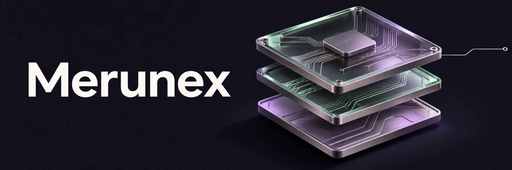

I’m **Daniil**, a full-stack developer. I care about clear architecture, thoughtful database design, and software that’s useful in everyday work.

**[Repositories&nbsp;↗](https://github.com/Merunex?tab=repositories)** · [Stars&nbsp;↗](https://github.com/Merunex?tab=stars) · [Friday&nbsp;deploy&nbsp;↓](#friday-deploy)

## What I build

<details>
<summary><strong>Web apps &amp; backend services</strong></summary>

I build database-driven apps with PHP, JavaScript, and MySQL. I like to get the data model right early so the interface and business logic are easier to maintain as an app grows.

[Explore web development on GitHub ↗](https://github.com/topics/web-development)

</details>

<details>
<summary><strong>Telegram bots &amp; automation</strong></summary>

I use Python and Telegram to turn recurring tasks into chat commands and connect conversations to backend services.

[Explore Telegram projects on GitHub ↗](https://github.com/topics/telegram)

</details>

<details>
<summary><strong>Local AI integrations</strong></summary>

I’m exploring how locally run language models fit into apps and bots, especially when they can help with a specific step in an existing workflow.

[Explore local LLMs on GitHub ↗](https://github.com/topics/local-llm)

</details>

## Toolbox

<p>
  &nbsp;
  &nbsp;
  &nbsp;
  &nbsp;
  &nbsp;
  &nbsp;
  &nbsp;
  &nbsp;
  
</p>

## Contribution snake

<picture>
  <source media="(prefers-reduced-motion: reduce)" srcset="./assets/contribution-calendar.svg">
  
</picture>

<!-- contribution-summary:start -->
**56 contributions across 17 active days** in the last 365 days.
<!-- contribution-summary:end -->

The snake eats bright green food and the dots on real contribution days. It fills the board and starts another round. The route changes daily.

## Friday deploy

<details>
<summary><strong>It’s Friday, 17:59. The tests are green.</strong></summary>

<details>
<summary>Deploy now</summary>

```text
[OK]  Production is up.
[OK]  Dashboards are green.
[!]   Slack: “Quick question…”
```

</details>

<details>
<summary>Schedule for Monday</summary>

```text
[OK]  Deploy queued for Monday.
[OK]  Weekend unlocked.
[i]   Your laptop can finally nap.
```

</details>
</details>
